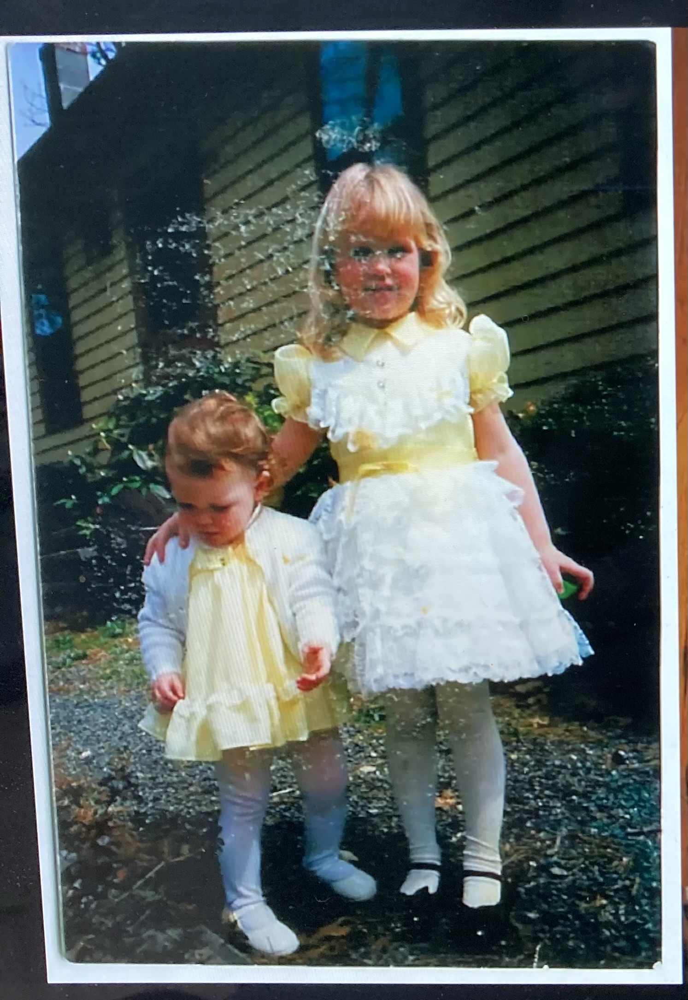
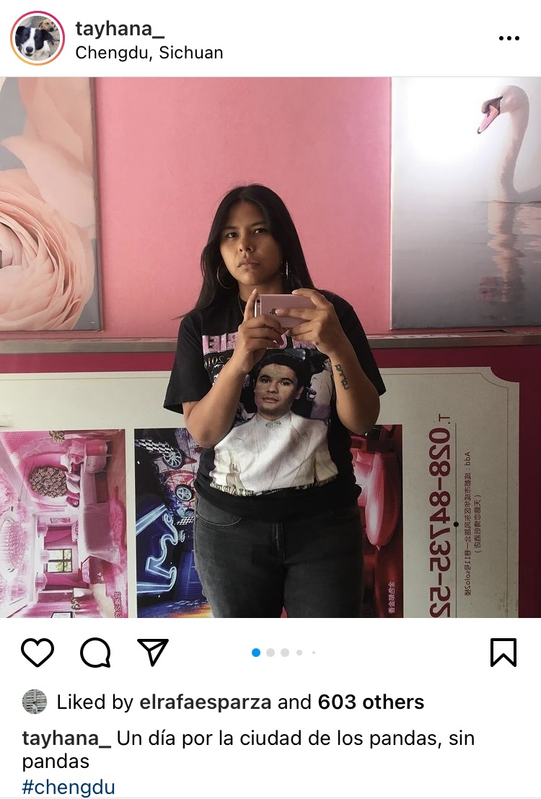
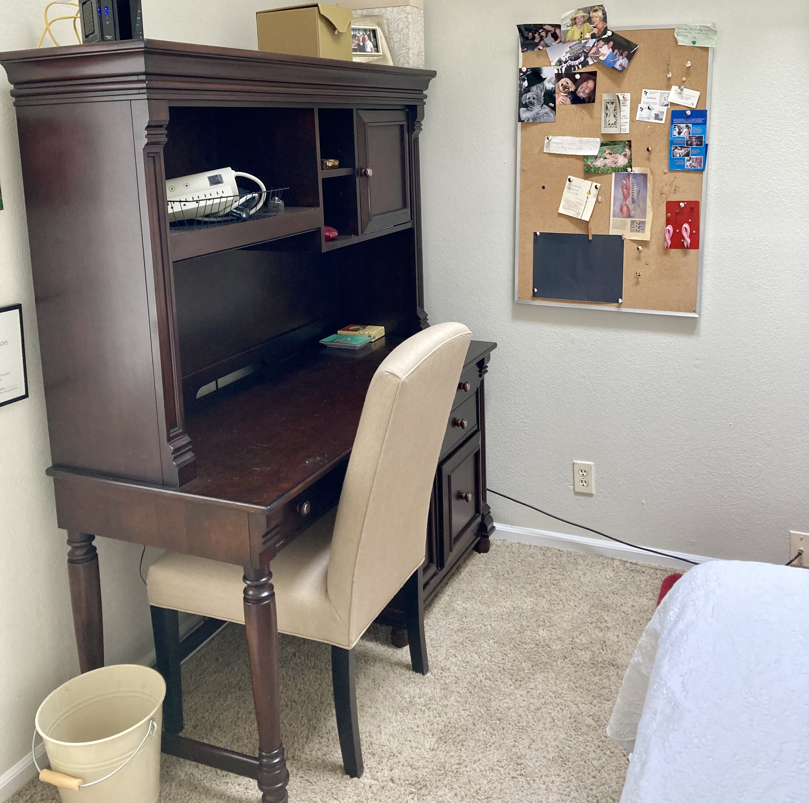
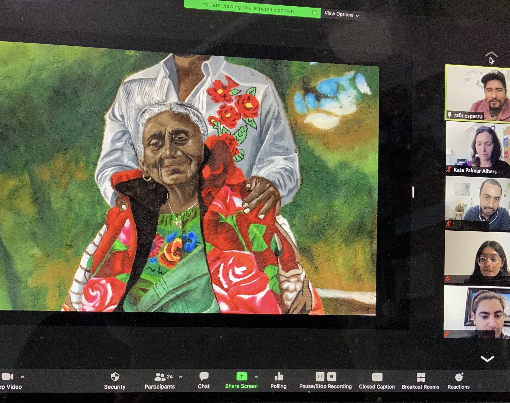
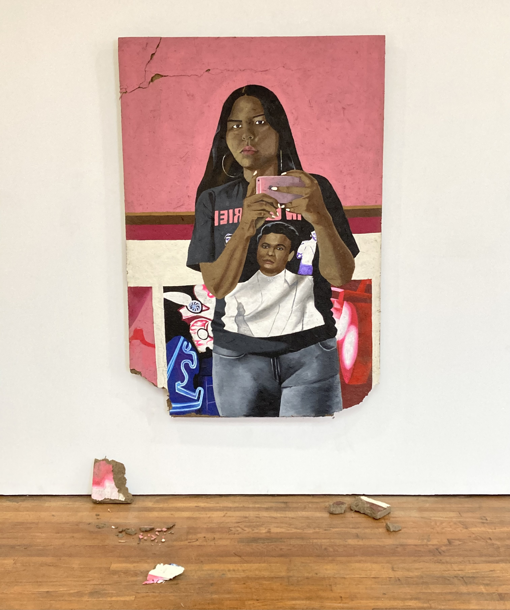
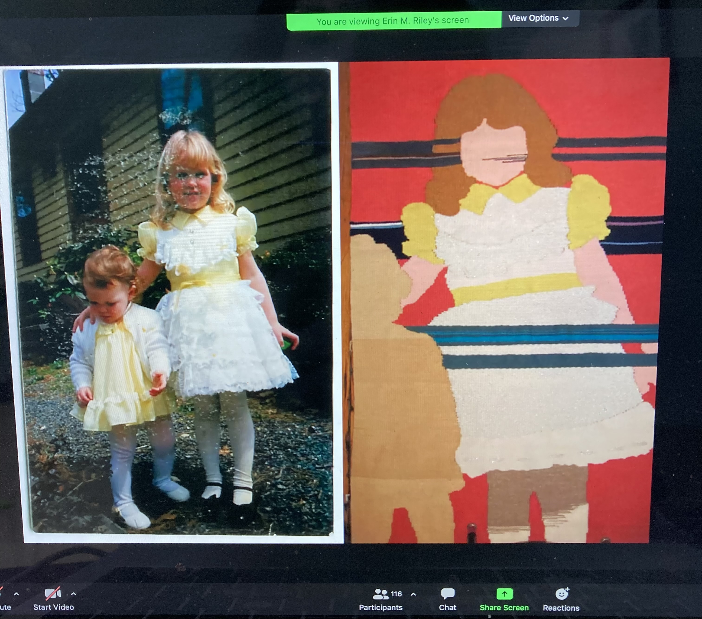
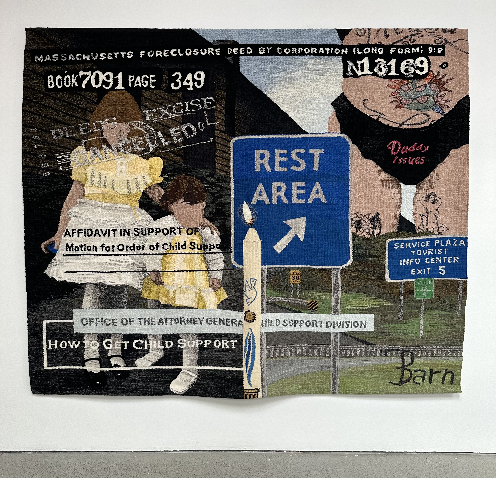
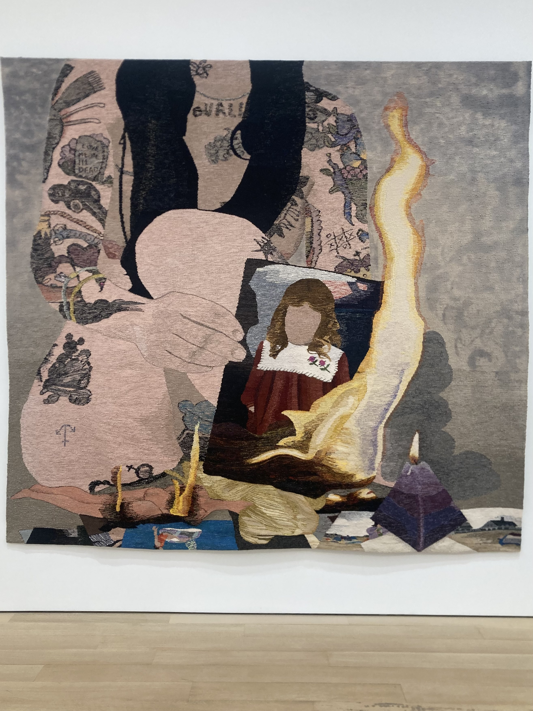

*Note to reader: this essay begins in Denver in 2021 and ends in Los Angeles in 2024. The lag time seems fitting given the focus on photographic source images moving into different material manifestations, and the slower pace of seeing objects in person than images on screen.*

***********************************

**March 2021 (via August 2021)**

**1.**

The small photo popped up on my screen: two little girls decked out in their yellow and white Sunday best, the elder maybe five years old — soft blond hair, white frilly dress, white cotton tights bagged a little at the ankle, special black flats with an ankle strap — leaning protectively toward the younger, her arm gently encircling her little sister, a toddler, really, similarly dressed up in a loose yellow dress, sweet white cardigan, and those same sweetly bagged white cotton tights, so emblematic of little girls dressing up. Though the older sister is poised enough to look toward the camera, the smaller girl looks down, either unsteady in her step or simply immersed in her own world of attention, not yet aware of conforming to the camera’s wishes by adjusting her pose or gaze. 

The girls stand on a gravel walk, in front of a wooden-sided house – on their way to church, perhaps, or, I imagine, an Easter celebration. I am struck by what seems like a small paradox at the heart of the image: it is the girls’ everyday familiarity and comfort with one another, expressed through their gesture and ease, that compels me, a stranger, decades later, to feel moved by the photograph, and yet, the only reason the camera was present was precisely because it was not an everyday moment, it was deemed “special” and thus record-worthy by some older family member’s interest in their dresses, the day. But, still, the camera catches the ordinariness of their mutual gesture more beautifully than the occasion that caused the picture.
The girls’ hands are their own story, shifting exquisitely in mood. I read, from left to right, alternating from younger to older: relaxed, protective, open, clenched. That last word gives me some pause, however – I do a google image search of “clenched hand”, and, then, looking for something closer, “clawed hand”. I’m wanting the word to match the image, but it stays elusive. 

*********************

Another photo, a few days later, on a different screen. I am on my phone, looking through the DJ Tayhana’s Instagram feed. I’m new to this musician, she has just over 8,000 followers; nine people I know follow her. A few rows down in her grid, I’m startled to find what I’m looking for. It’s a mirror selfie: we (“we” Instagram viewers) see Tayhana regarding herself, her dark skin, brown eyes, and long dark hair offset by the pink wall behind her and the rose gold iPhone that she holds to take the photo. It’s the same iPhone, the same rose gold, as my own. She wears hoop earrings, a black band shirt, black jeans; she looks at herself warily, unsmiling. The blank pink wall behind her is interrupted on the left by a poster of a blooming pink rose, and, on the right, by a canvas featuring a pink swan. The text on her shirt, reversed in the mirror’s reflection, is also pink. The image is both feminine and, somehow, an antithesis of femininity – the sweetness of the pink edged out by the stark gaze, the black denim, her stance. Tayhana posted the photo on October 13, 2019 on a trip, it seems, to Sichuan, China. The selfie is the first image in a photo dump from the trip; she also saw the pandas the city is famous for. I learn she is an Argentinian-born DJ and music producer, active in the LGBTQ+ club scene in Mexico City.

<figure class="figure-pair">
	
  
	<figcaption>
		Screenshots from artist Erin Riley's talk on Zoom and Tayhana's Instagram feed, both April 2021, both discussed below
	</figcaption>
</figure>

******************

**2.**

Like the photo of the little girls in yellow & white, I am looking at Tayhana’s selfie only for indirect reasons, and yet that shared indirectness seems entirely the point. It’s early spring 2021. I have been teaching on zoom for a year and, over the course of that year, have felt the uncomfortable contraction of my own ability to look at art, to look at photographic objects. Without opportunity for field trips or other non-zoom classroom experiences, I have tried to counteract this narrowing for my students with a series of visiting artists, and I’ve been binging on zoom artist talks on my own time, too. 
I am in Denver as a visitor; I am sitting in the upstairs bedroom of my in-laws’ neighbor’s condo, which I’ve converted into a temporary office, or, rather, classroom, as a temporary reprieve from my garage in Los Angeles, which has otherwise served as my zoom classroom for the past year. My family is renting my in-laws’ neighbor’s condo for a month and, unlike airbnbs where owners have typically taken care to remove the most personal touches of their private spaces in order to appeal to more guests, this rental is less professional and more familial. It still contains the personal touches of its owner, a sixty-something divorcée who I only know through her belongings. I know, for instance, from the framed certificate she has hung directly at eye level across from the toilet that she climbed Mount Kilimanjaro a few years ago; I know from the bookshelves at her bedside that she likes to read inspirational self-help books in bed, titles like *Embracing our Essence* and *Return to Wholeness*.

Over the course of zoom teaching, I have remarked again and again—anytime someone asks me what it’s like teaching class this way—on the strange intimacy it affords into my students’ lives. In the first stressful and adrenaline and fear-fueled weeks of the pandemic, students collectively shared the inner spaces of their homes: I saw bedroom walls with K-pop posters, met family pets, noticed who had a quiet space and who didn’t, picked up on familial love and tensions, glimpsed elderly grandparents hobbling by in the background. I was often genuinely moved by these spaces: the student who was taking art history on a whim but who had covered the entire wall by her bed with cut out reproductions of artworks she liked; the enlarged quinceañera photos; the student whose room was decorated with her dad’s art; the family vacation souvenirs. I fretted over my own zoom background, in my hastily reconfigured garage, and made a kind of grateful and defeated peace with the homespun bookshelves and Home Depot can lighting (fortunately, RoomRater did not yet exist and I’d never heard of a Ring light). While, on some level, I relished these humanizing moments, most of the students didn’t…. over the months ahead, people more frequently chose neutral backgrounds, virtual backgrounds, or, by a full year later, most common by far, the cameras were off altogether. 

It’s exhausting being seen. And, while I wasn’t consciously aware of it at the time, I must have felt a certain reprieve from my own self-imposed year-long zoom frame when I set up my computer at the desk in the in-laws’ neighbor’s upstairs bedroom. I noticed that, now, I was surrounded in the rectangular frame not with my own books, but with the homeowner’s personal effects: her bulletin board, featuring photos of her dog and her boyfriend, some sweet notes from the boyfriend. It was a far more personal look at a home space than the bookshelves I was used to sharing, and, appealingly, it wasn’t even me. I hadn’t mentioned to either my colleagues or students that I had left Los Angeles, so there was no reason for anyone not to assume this was my dog, my partner, my bulletin board – the personal space that defined me. I enjoyed inhabiting that space, enjoyed glimpsing this other environment as I, invariably, caught my own screen in the zoom grid of class.

<figure class="figure">
	
	<figcaption>
(not) my bulletin board – but the personal space that defined me
	</figcaption>
</figure>

*****************************

**3.**

Back in Los Angeles, in early April 2024, I finally see the painting, in real life, that was inspired by Tayhana’s mirror selfie. It’s hanging in the LA artist rafa esparza’s new show, *keeping*. esparza had been a visiting speaker in one of my spring classes; I’d met him over zoom from that upstairs bedroom, and he’d talked with my students about his newest work, paintings and sculpture in a newly opened exhibition at the gallery Commonwealth & Council. I’d asked him to speak about the ongoing use of adobe in his work and, in particular, his interest in photographs. He hadn’t shown any of his source photos for the new adobe paintings, but, when he mentioned Tayhana’s was from Instagram, I’d looked it up. 

<figure class="figure">
	
	<figcaption>
	With thanks to rafa esparza for joining my class in Spring 2021 for an artist talk.
	</figcaption>
</figure>

Photographs that become the subjects of artworks in other media occupy a particular experiential niche. Most photographs today travel between locations and platforms quite fluidly: made initially, perhaps, on a cell phone, then migrating outward into other contexts by text or social media. Other photographs, occupying the realms of advertising or journalism, may move rapidly through both physical and digital spaces, gaining slightly different meanings in each new situation, with each new viewer. Even photographs made primarily to exist as objects of contemplative aesthetic experience, destined to hang in galleries or be optimally displayed in the pristine white space of an artist’s book, travel into social media, racking up likes and comments, functioning simultaneously as PR and as a creative lifeline, connecting artwork to viewer. But this type of subtle shift is markedly more deliberate, and specific, when photographic images are plucked/pulled into/rendered in paint, or cast as objects, or woven into textiles. 	

In esparza’s case, the effect is magnified as the photograph is rendered in acrylic paint on an adobe surface that visually integrates subject matter with material surface. Adobe, of course, is mostly dirt: a mud and straw mixture, baked in the sun to harden into a durable building material. For esparza, it doubles down on the familial and personal imagery that characterizes much of his work: the artist learned adobe techniques from his father, an adobe brickmaker in Mexico. Not only does the imagery incorporate domestic and familial subjects, so, too, does the material. And, in a strange reversal of image conservation, in this case the image transfer has not served to perpetuate the life of the image, but, rather, to shorten it. I’m thinking of a precedent like the 1970s photorealist artists: in the case of Robert Bechtel, for instance, rendering a personal snapshot in acrylic paint on canvas created a longer-lasting image, a more durable object, given the fragility of paper and chemical processing as compared to paint on canvas. But adobe, despite its advantages as a building material, is not so stable as a surface for paint. esparza has underscored this truth by allowing—even, perhaps encouraging—the images rendered in adobe to crack, even crumble.

<figure class="figure-lg">
	
	<figcaption>
	rafa esparza, Tayhana, 2021, Acrylic on adobe, Approx. 70.75 x 48 x 1.5 in. From his exhibition "keeping" at Commonwealth and Council, Los Angeles, 2021.
	</figcaption>
</figure>

*********************

**2024**

**4.**

Three years pass before I see Erin Riley’s weaving of the little girls in yellow. I’d like to say it was March 2024, to claim the symmetry, but it was April – 3 years and one month since I’d attended an artist talk she gave by Zoom to a group of students in England, from her home in Brooklyn, which I’d attended from that upstairs office in Denver. A mainstay of Riley’s weavings is her own self-image, often recorded as the moment of making a selfie, perhaps reflected in a bedroom mirror—a private moment of self-regard shared publicly only when transformed into a weaving presented as fine art. Riley had been discussing these weavings in the 2021 zoom talk. Personal family photos and old childhood snapshots also appear as subject matter, often alongside an intimate array of everyday objects, from prescription medication, home HIV tests, and tampons to personal journals and newspaper clippings. Documents appear again and again in her weavings, alongside the detritus of everyday life. Court orders, eviction notices, prescriptions—the stuff of beurocracy that even while testifying to trauma and abuse always masks the individual human beings named. Carried forward into these contexts, the photographs speak the palpable sense of childhood experience persisting, for better or worse, into adulthood.

In the zoom, Riley had shown the snapshot of the two young girls side-by-side on the screen with an example of a weaving she’d done relatively early in her career: the girls in the photo were, in that early weaving, graphically simplified and rendered on a predominantly red background, and the sole focus. As is typical in Riley’s weavings, her faces are anonymized, blank, which has the effect of simultaneously tying them to the particular and distinct photograph while also connecting outward, they could be “any young, white girl”. At the gallery in Los Angeles, I didn’t remember the weaving with the red background that I’d seen three years before, but I remembered the photograph instantly. 

<figure class="figure">
	
	<figcaption>
	
	</figcaption>
</figure>

The new weavings in the gallery are large, often 8’ wide but one as large as 26’ wide; collectively they are titled “The Invisible Third”, and mirror the title of a poem by the artist. The paper trail of domestic violence appears alongside the everyday effects of house and home. The sweet sentiment of the photographic source is fully immersed in reference to foreclosure and to a child support affidavit, immediately subsuming whatever seemingly special childhood event was captured under a larger narrative of familial disruption. The right half of the woven panel shows the artist-as-adult, her torso and pelvic area cropped into close up view and in visual dialogue with the literal signs of a highway rest area, suggesting flight from—or with—harm.

<figure class="figure-lg">
	
	<figcaption>
	
	</figcaption>
</figure>

	

Other childhood photographs appear through Riley’s work both in this show and elsewhere. A year earlier, I’d seen a large weaving by Riley on view at her New York gallery in which she renders a larger-than-life sizer version of herself burning a childhood photograph, a girl with the same mid-length hair and smocked dress of a little girl from another era. 

<figure class="figure">
	
	<figcaption>
	
	</figcaption>
</figure>

In both, it is clear, the easy storytelling a stranger’s family photograph might evoke may be deeply at odds with the personal memory. The source image reveals scant contextual details beyond the clapboard siding of a home in the background. I return to the clenched hand that had given me pause in my initial view of the photograph; here, in the weaving, the image is laterally reversed, but the hand is just as tense. Anchoring the imagery at the center is a single illuminated baptism candle, suggesting an initial promise or ritual, perhaps the event at the heart of the photograph: not Easter, as I had initially guessed, but a different and more personal religious and familial ritual. One flame promises a future, the other destroys evidence of a past.

	
*****************

**5.**

Each year, I ask my students to reflect on the personal photographs that mean the most to them. Always, the stories vastly exceed the frame of the image. Even the most humble image can evoke these depths of narrative—if only for an audience of one. In moving such images from one material to another, Riley and esparza demonstrate a kind of care and attentiveness that distills these unfolding dynamics; their pauses from one material to the next mirroring the accumulations of meaning—allegiances, connections, associations—as such photographic images move through time. 

