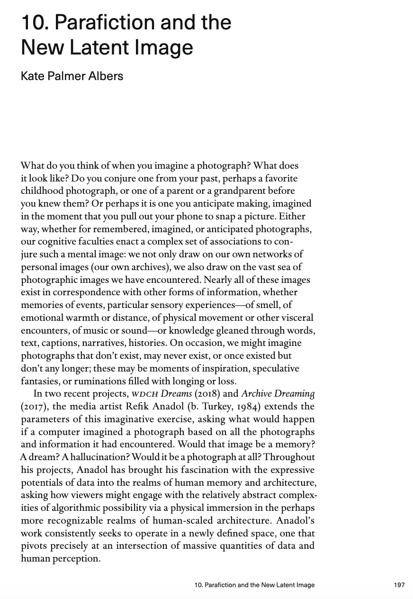
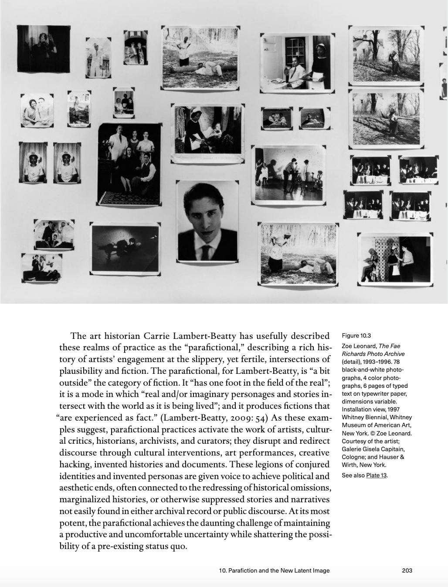
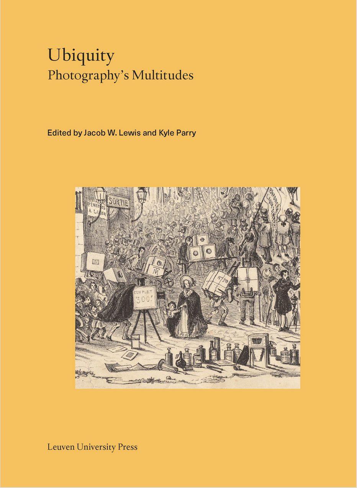

<figure class="figure">
	
	<figcaption>
	The opening of my essay in Ubiquity: Photography's Multitude, published in 2021 by Leuven University Press... download the full essay or pdf below.
	</figcaption>
</figure>

What fantastic company, in this evergreen topic of photographic ubiquity… thank you Kyle Parry and Jacob W. Lewis for including my essay, “Parafiction and the New Latent Image” in this edited volume. I got to write about the data artist Refik Anadol’s public performance of an archive-mining AI program that generates newly imagined images for the archive (in this case, the LA Philharmonic’s archive, as projected on Walt Disney Concert Hall in 2018) and, one of my all-time favorites, "The Fae Richards Photo Archive" (1993-1996), by Zoe Leonard, emerging from her work with filmmaker Cheryl Dunye. Both gave me a great excuse to dive into Carrie Lambert-Beatty’s concept of the “parafictional” as a productive avenue into artists’ engagement with the slippery and fertile intersections of plausibility and fiction — particularly when it comes to narratives not easily found in either archival record or public discourse.

<figure class="figure">
	
	<figcaption>
	Excerpt of my essay in Ubiquity: Photography's Multitude, published in 2021 by Leuven University Press, with a detail of Zoe Leonard's "Fae Richards Photo Archive"...download the full essay or pdf below.
	</figcaption>
</figure>

The editors, Parry and Lewis, got the book made as an open access edition, which means you can download the entire thing, free, [here](https://lup.be/products/130787), and a pdf of my essay here. 

<figure class="figure">
	
	<figcaption>
	Ubiquity: Photography's Multitude, published in 2021 by Leuven University Press
	</figcaption>
</figure>

