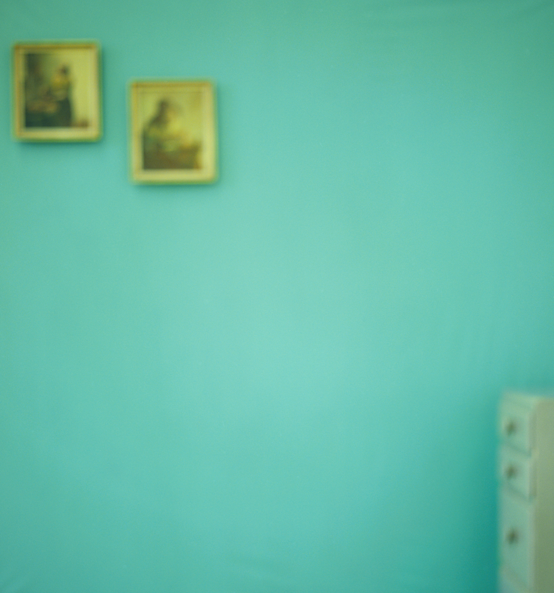
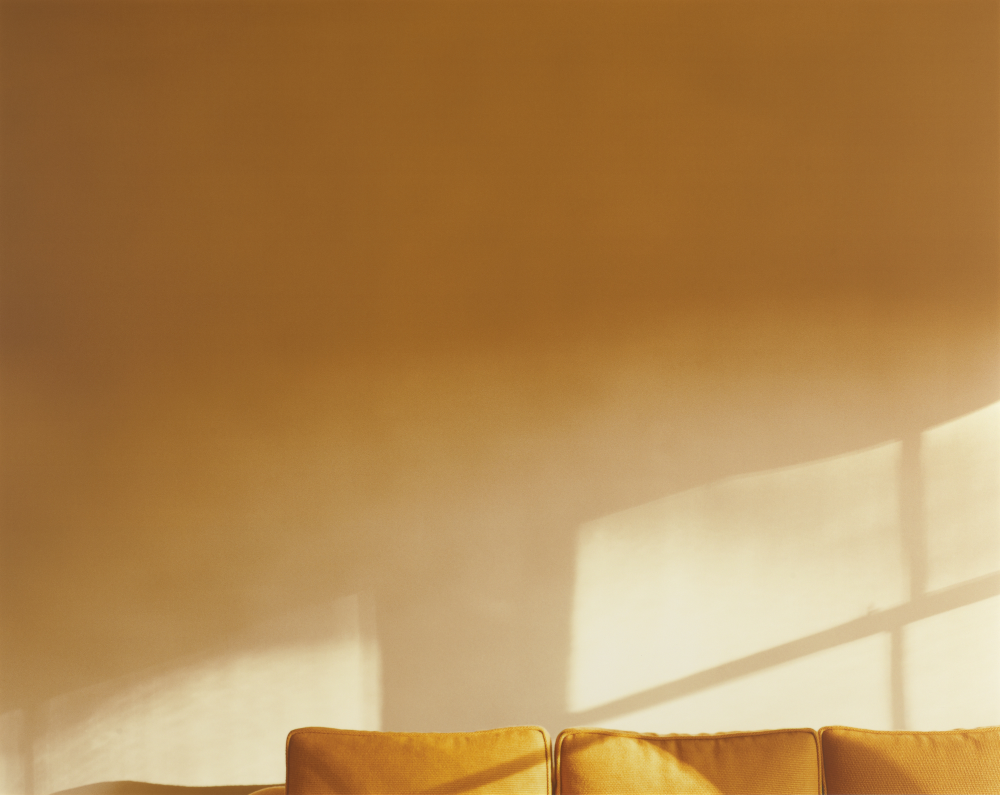
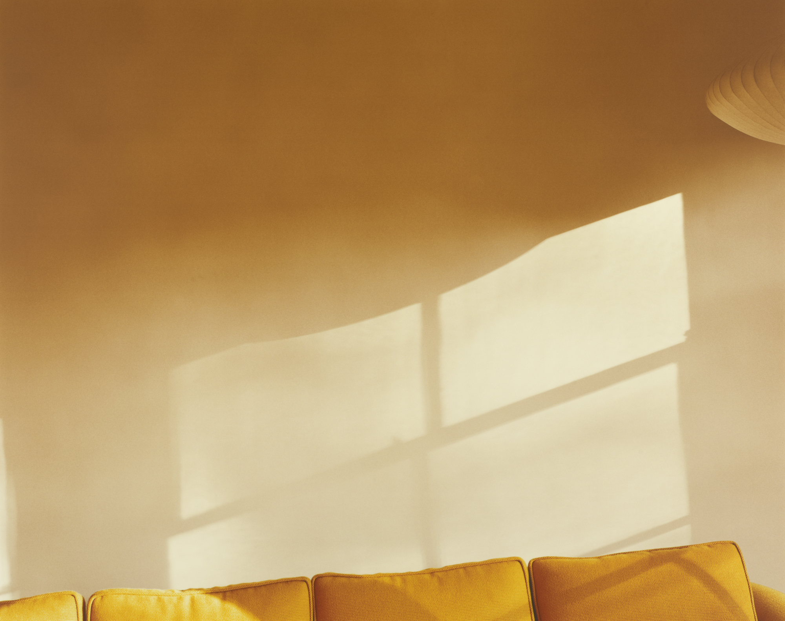
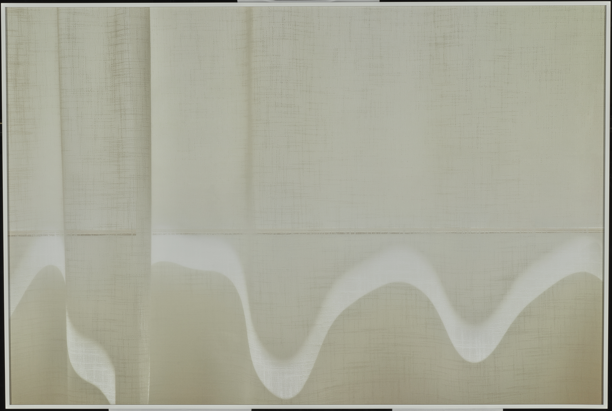
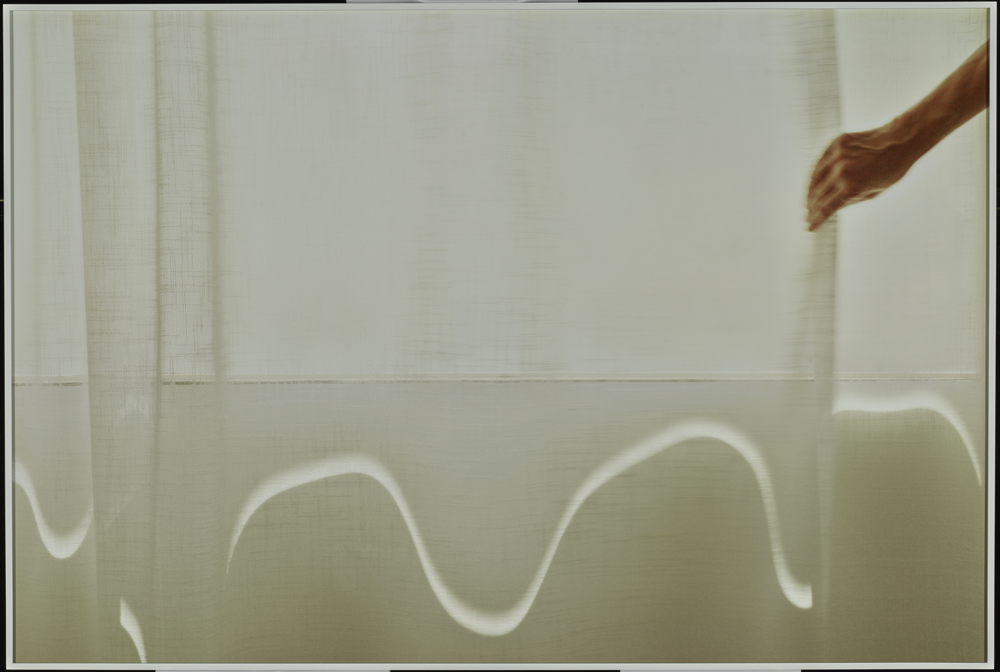
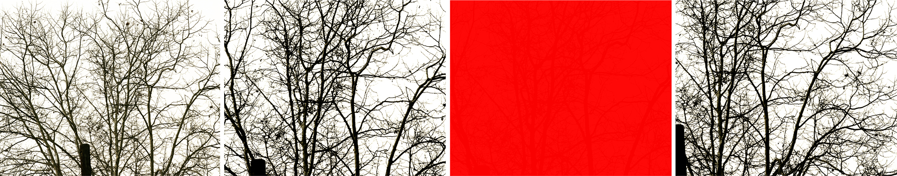
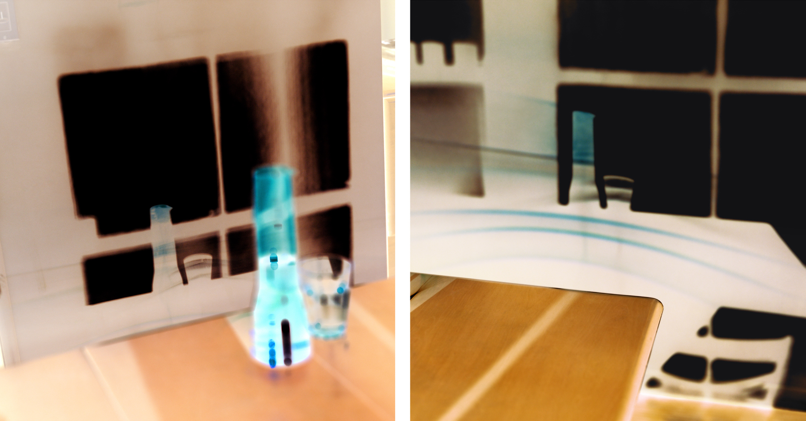

**This exhibition review of the exhibition *Uta Barth: Peripheral Vision* was published in *Aperture* magazine on February 3, 2023 with the title "What Uta Barth's Images Tell Us about the Limits of Sight". You can read it online [here](https://aperture.org/editorial/what-uta-barths-images-tell-us-about-the-limits-and-possibilities-of-sight/).**

*******************

In the fall of 1996, Uta Barth exhibited her then-new series *Field* and *Ground* at Tanya Bonakdar Gallery in New York. Barth was living in Los Angeles, having joined the art faculty at the University of California, Riverside, in 1990 after earning her MFA at UCLA in 1985. The critic Mark van de Walle [reviewed](https://www.artforum.com/events/uta-barth-6-212047/) the show in *Artforum*, invoking Barth’s relationship to the minimalism of Agnes Martin, the play between photography and painting in Gerhard Richter’s blurred paintings, and the sensitivity to light shared by Vermeer. Even in this foundational work for Barth, she was understood in relation to a long and significant history of artists. Van de Walle mused that Barth’s photographs, “by virtue of being pictures of nothing in particular, manage to be about a great deal indeed.” 

<figure class="figure">
	
	<figcaption>Uta Barth, Ground #42, 1994, from the series Ground (1994–97)
	
	</figcaption>
</figure>

At the time of that show, I had just moved to New York, as a recent college graduate, and happened to be working at a photography gallery down the hall from Tanya Bonakdar Gallery. I wasn’t reading *Artforum* regularly and had only just begun to learn about photography, but I must have stopped in to look at Barth’s show dozens of times. I still remember stretching my breaks during the workday as long as I thought I could get away with, to sneak in a few more minutes with Barth’s photographs. I would stare at them, and consider what they were telling me about photography, about seeing, about how to signal what matters. 

Both of those early series––*Field* (1995–96) and *Ground* (1994–97)––feature prominently in Barth’s current major exhibition at the J. Paul Getty Museum, [*Uta Barth: Peripheral Vision*](https://www.getty.edu/art/exhibitions/barth/index.html), curated by Arpad Kovacs. Filling the entirety of the museum’s West Pavilion photography galleries, the exhibition is a generous and expansive look at the artist’s key bodies of work from the 1990s up through the present. It opens with *…from dawn to dusk* (2022), a work commissioned by the Getty. On view for the first time, these new images crystallize the artist’s ongoing fascination with the fleeting effects of light on place and the potential of photography to sequentially capture and reflect this human, and bodily, experience. Notably, in a side gallery, Kovacs also includes Barth’s very early and experimental work from the late 1970s and ’80s: rarely seen collages, self-portraits, iterative sequences of space, and experiments with light and its blinding capacities—all early traces of ideas that will persist and play out for decades.

The early *Field* and *Ground* series established Barth’s commitment to disrupting the conventional habits of photographic seeing. Here, the camera’s focus is not associated with objects but with space, foregrounding color, compositional arrangement, and a fundamental question about how both photographic and human vision affect perception and experience. Barth does a lot with a little: a wall, a light fixture, the edge of the frame, a window, or light as it lands. These elements form relationships that are as intricate and nuanced as they are spare. Later works, such as *…and of time* (2000), *…and to draw a bright white line with light* (2011), and *Compositions of Light on White* (2011) express the refinement of these ideas, along with Barth’s exquisite attention to the most ordinary domestic surroundings. In Barth’s photographic world, the soft glow of a shifting line of light becomes everything. That these photographs are made in her own home quietly establishes the grace of our everyday, most immediate, and most personal surroundings.

<figure class="figure-pair">
	
  
	<figcaption>
		Uta Barth, Untitled (…and of time, 00.4), 2000
	</figcaption>
</figure>

<figure class="figure-pair">
	
  
	<figcaption>
		Uta Barth,…and to draw a bright white line with light (Untitled 11.2), 2011
	</figcaption>
</figure>

Among Barth’s great strengths is her ability to play with options, to present variations on a theme, not as variations in and of themselves but as a true reflection of and insight about how we look, and how it feels to look, again and again, over time. This dedication plays out intensively in the series *white blind (bright red)* (2002) and *Sundial* (2007), both of which are given whole galleries. These rooms most effectively shift the psychology and mood of the exhibition from the meditative and contemplative beauty of the ordinary to something more visceral and acutely destabilizing, even strange. The installation of *white blind (bright red)* is purely linear. An even line of photographs depicting gnarled tree branches in winter, punctuated by color inversions, shocks of entirely red or nearly black frames, and washed-out images of the same branches, barely visible, surround the viewer. The effect, moving from image to image, mixes sight with both the memory of sight and with literal afterimages—a convergence of vision and its effects, which, Barth seems to suggest, are really one and the same. She made these photographs during a period of convalescence, looking out a window from her bed, recovering from an illness. We may think of vision as occupying a largely conceptual realm—the eye and the mind—but Barth shows a distinct bodily awareness of vision. Both may be as universal as the other, but an acute sense of the physicality of vision, and visual processing, *feels* like the greater revelation. Standing in the gallery, I can envision my own self, lying in bed, looking out the window, again and again, waiting in a space of vulnerable limbo, to be well. 

<figure class="figure-lg">
	
	<figcaption>Uta Barth, white blind (bright red) (02.13), 2002

	</figcaption>
</figure>

*Sundial* offers a similarly complex and slightly surreal vantage point on what it might mean to spend a lifetime looking closely, or even a few minutes. Barth invites us to stare with her, tracking the warm play of late afternoon light on the refrigerator, the floor beam, the edge of a cabinet. Soon enough, like a familiar word spoken over and over, the everyday becomes strange, and it is evident that total attentiveness to the real can be slightly hallucinatory.

<figure class="figure-lg">
	
	<figcaption>Uta Barth, Sundial (07.4), 2007, from the series Sundial

	</figcaption>
</figure>

In their foregrounding of the complex physicality that can be associated with vision, *Sundial* and *white blind (bright red)* offer a contrast to several of the other series featured in the show, where mindfully contemplating the subtle passage of light feels more aspirational, like what one’s best self does, the most focused, clearest, and attentive version of vision. But, Barth shows, vision also comes from sick and tired bodies, aging or just-awoke-and-still-disoriented eyes. This sight is wrapped up in our bodies, this sight is unstable, this sight second-guesses itself. Remarkably, no matter which version of sight she is prompting viewers toward, Barth’s photographs do not just depict these experiential states. Rather, they make the viewer’s re-enactment of them possible. Ultimately, both are equally part of our existence and relevant to an experience of a world that is, at once, visual, perceptual, felt, lived, embodied, subjective, flawed. And, yet, coherent. 

*********************************

The exhibition was on view at the Getty Museum in Los Angeles November 15, 2022 through February 19, 2023. 

The eponymous publication, edited by Arpad Kovacs, came out in 2024. 

 

