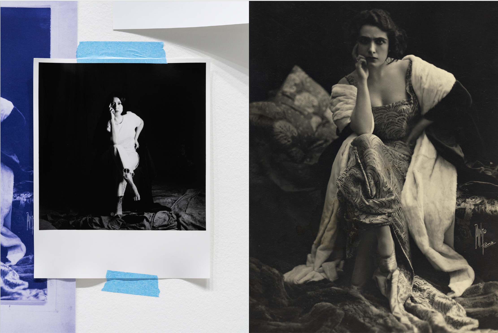
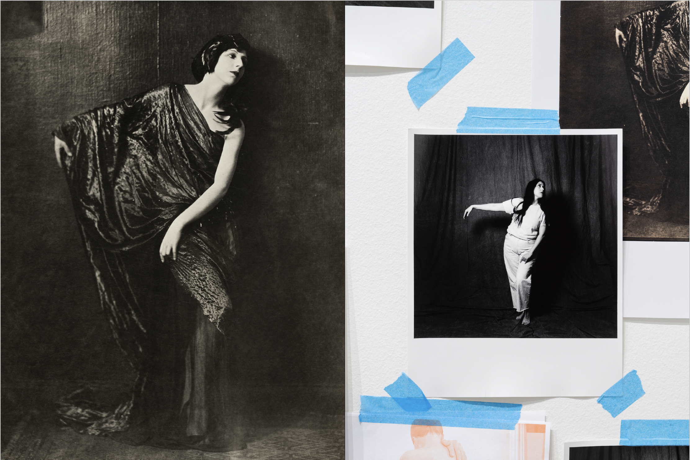
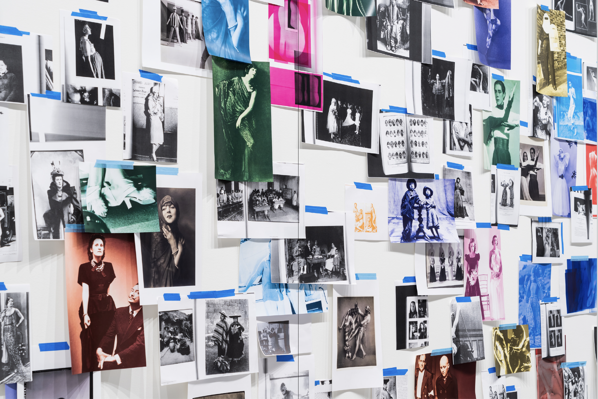
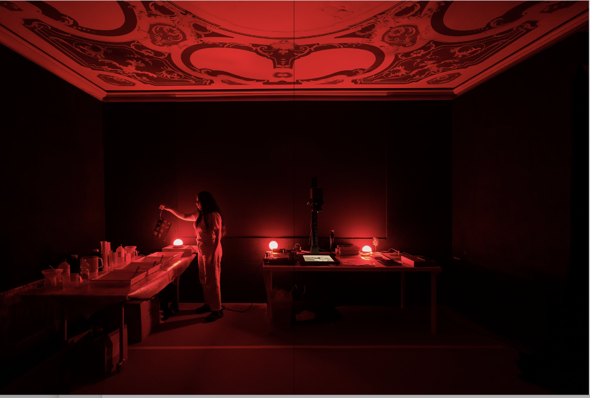
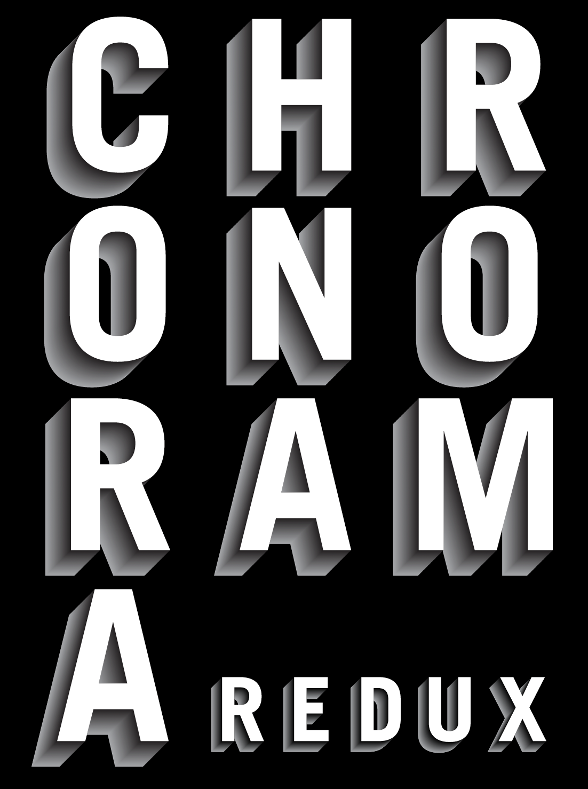
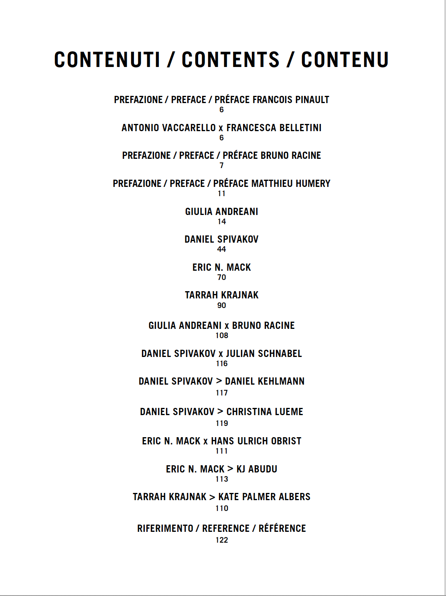

**I was lucky to see Tarrah Krajnak perform her ongoing project RePose in May, 2022 at CalArts REDCAT in Los Angeles, with assistance from Elizabeth Hibbard. This essay is included in the catalog for the exhibition [*Chronorama Redux*](https://www.pinaultcollection.com/palazzograssi/en/chronorama-redux), where Krajnak performed a new iteration of the project at the Palazzo Grassi in Venice, Italy. The work stayed on view from December 3, 2023 through July 1, 2024.**

*******************

<figure class="figure-lg">
	
	<figcaption>
	
	</figcaption>
</figure>

What is the lifespan of pose? Typically, we might imagine it to be both fleeting and continuous with the fluid movement of a person. A photograph of any one pose, however, both removes the pose from movement and extends it through time. In the most famous photographs, many of which are on view in *Chronorama*, these fleeting moments may be scrutinized by a multitude of viewers over generations. Does a woman’s stance indicate power or vulnerability? Does her pose convey energy, or anxiety, or stability? Is there lightness and dynamism, is confidence inspired?  Through their pose, is a person understood as empowered, alluring, or even revolutionary? 

We all pose, and we are all masters of decoding the body language of a pose. Particularly in the photo-saturated world of contemporary life, viewers may identify equally with the experience of striking a pose for something as simple as a casual snapshot as with evaluating the cultural look of a professional model or artist’s subject.   

<figure class="figure">
	
	<figcaption>
	
	</figcaption>
</figure>

The artist Tarrah Krajnak (b. Lima, Peru, 1979) raises the stakes considerably when she asks us to consider what it means to RE-pose. Krajnak invites us, as viewers, to become participants in this realm of revisiting photographic subjects. She offers a selection to begin with, beckoning us into a new—and newly intimate—view of shared photographic references. Some of the images may be familiar to us, others not. In contrast to the framed photographs carefully organized through the *Chronorama* exhibition space, Krajnak’s performance and ongoing intervention is filled with an extensive and colorful array of photocopied images, temporarily affixed to the walls, salon-style, with blue painter’s tape and a casual air that is belied by the scope and intensity of the selection. The artist’s electric curiosity about the images that surround us—the images of women that surround us—is contagious. 

<figure class="figure-lg">
	
	<figcaption>
	
	</figcaption>
</figure>

Embedded within the sequence of *Chronorama*, viewers arrive to Krajnak’s performance-installation primed to respond, perhaps with a gaze both critical and admiring, to an orchestrated sea of photographic representation. Viewers will have seen work by many of the great photographers in Condé Nast’s archive and history: Berenice Abbott, Cecil Beaton, Lee Miller, Irving Penn, Helmut Newton. Krajnak offers a powerful disruption to this genealogy of poses. On a stage that mimics the space of a photography studio, replete with backdrop, lighting tools, camera, tripod, and mirror, Krajnak works together with an assistant to recreate the women’s poses, live before the viewers, for a new photograph. In the slow time of this live work, Krajnak and her assistant methodically enact a performance that functions both as reenactment and critique.

Perhaps it is obvious that poses are necessarily bodily. But what does it mean to move one’s body into the shape of another? Who “fits” the pose, and who doesn’t? In a survey of historically and aesthetically impactful photographs, it is easy to find images of white women with bodies and features that define Eurocentric standards of beauty. Krajnak’s project both points out the hypervisibility of this narrow demographic, and seeks, through casting her own Indigenous body into such a survey, to disrupt it. Crucially, the disruption is productive: it creates a revised framework for connections, across time, race, nationality. Krajnak’s lived experience as born in Peru and adopted by white parents into an American family make her both keenly attuned to and compelled by these generational complexities, as they find momentary shape and form in the space of a still image.

As importantly, **RePose** centers how gendered bodies claim or renounce power. We are living in an era where women can watch a viral YouTube video to learn about the physiological impact of moving our bodies into a so-called “power pose”: instead of sitting demurely, crossing our ankles or legs, taking up an “appropriate” amount of space as so many girls and women intuitively learn over the span of years, we could try standing with our legs wide, arms overhead, taking up space. From the Condé Nast archive, Krajnak re-enacts, for example, Helmut Newton’s 1975 “Woman Examining Man”, a photograph that already shocked Vogue readers of the time for the beautiful female model’s “man-spreading” pose and inversion of the male gaze as she predatorially eyes a shirtless man in the foreground. Typically for **RePose**, Krajnak’s new version doubles down on the implicit gender dynamics of the original pose and gendered power dynamic of situation, now replacing the white male photographer with an Indigenous, female artist rendering her own self-image. The shift in energy and mood is palpable.

<figure class="figure-lg">
	
	<figcaption>
	
	</figcaption>
</figure>

We are also living in an era where computer vision has begun the challenge of automating the process of decoding human emotion from visible cues. This automation began with learning human facial expressions, and is moving on to learning and identifying human emotion based on the configuration of the body. Based on pose. 

It is not just the eyes that are the window to the soul, it is the configuration of our limbs, the weight of our balance, the space we take up or deny ourselves. In **RePose**, Krajnak does anything but rest. Rather, in a deeply human way, she reimagines both the value and power of knowing history, creating relationships, and claiming space. Nothing could be more urgent.

<figure class="figure-pair">
	
  
	<figcaption>
		
	</figcaption>
</figure>

*********************************

 

