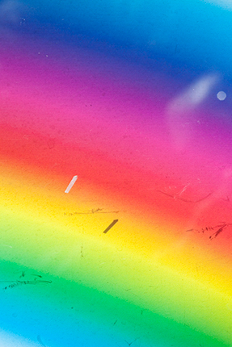
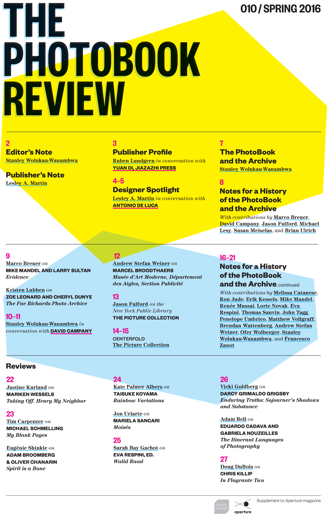

*Fueled by the energy of sabbatical, I've been looking through some old writing. I wrote this book review in March, 2016 and it appeared in the Spring 2016 issue of The PhotoBook Review, guest edited by Stanley Wolukau-Wanambwa. The last separate print version of The PhotoBook Review was in 2021. Sometime after writing this reflection on Taisuke Koyama's rainbows, I went through a phase of appreciating images of rainbows rendered in black and white.*

<figure class="figure">
	
	<figcaption>
	
	</figcaption>
</figure>

When I think of rainbows and photography, I can’t help but recall the YouTube video that went viral in 2010, recording a man’s palpably euphoric and tearful mix of wonder, urgency, and disbelief at witnessing a double rainbow. Over 42 million people have watched and heard his ecstatic bellows of “Double rainbow!” The man’s over-the-top emotional outburst underscores why rainbows are more commonly the province of pop culture—think Lisa Frank stickers, My Little Pony, and SpongeBob SquarePants memes—than serious art. I’ve been wondering recently about what the recipe is for contemporary photographic work to successfully engage with this kind of deeply populist subject matter. Sunsets, like rainbows, pose a similar aesthetic hazard… so what is it that causes me to have the thought, for example, that Paul Graham really knows how to pull off a sunset? Are rainbows an even harder subject than sunsets? One answer might be in how those rainbows are positioned to speak to nearby questions of looking, engagement, and photographic populism itself. 

Japanese photographer Taisuke Koyama has been thinking about rainbows-as-subject since 2009. While rainbows in popular culture are inevitably garish affairs, in the natural world they are something quite different: the result of the reflection and refraction of light into the full color spectrum, a purely optical phenomenon without physical dimension. Koyama’s book *Rainbow Variations* gathers together five series of his rainbow work and presents a collected engagement with the subject that, remarkably, consolidates these two seemingly contradictory views, while at the same time suggests the metaphoric possibilities of the rainbow in a time of endless digital mutability.

*Rainbow Variations* begins with a close-up of a rainbow in a Tokyo advertising poster, emerging from squarely within the context of cultural production. Yet in their repeated iterations and shifts throughout multiple series, in different material forms and processes, the characteristics of Koyama’s rainbows come to more closely align with their natural-world counterparts: they are reflected and refracted through light, shifting through space based on perspective and viewpoint.

*Rainbow Variations* is a slim volume, featuring a simple, two-toned white cover that alludes to the full spectrum of white light, interrupted only by a modestly sized title and author credit in a silver foil that, itself, reflects a rainbow. Inside, the refractions into distinct colors are sequenced in a systematic design. The images, all reproduced at full-page scale with a thin border, begin with subtle shifts of tone over indigo and violet color fields, and move sequentially by dominant color into a fractal, multicolored prism; the stilled, liquid patterning of waves; an organic and vaguely bodily dispersal of droplets over an appearance of glass, or even skin; and rainbow-hued stains of color, overlaid with bubbles.

Koyama pushes the color spectrum into both its geometric and organic variants, refracting color into an array of processes and forms. A tension emerges between surface and depth as some images appear pristine, while others are marred in minor ways: by a scattering of dust, errant scratches, or tape remnants left on an otherwise invisible viewing support. Perception shifts between a sense of directness in physical apprehension, and a mediated encounter.

The series’ names—Pico, Seventh Depth, Melting Rainbows, Rainbow Form, and Rainbow Waves—are revealed on a back cover flap, and underscore the central roles of mutability, experimentation, and differentiation in this variation of images within a variation of process within variation of a theme. Koyama’s rainbows ultimately both demonstrate and evoke a vast array of ocular possibility within the narrowest of ranges – a provocation that feels both hedonistically optimistic and a little bit staggering in our image-saturated era.

<figure class="figure-md">
	
	<figcaption>
	
	</figcaption>
</figure>

*********************************

**Note: The artist's project is documented [here](https://landscapestories.net/en/archive/2016/japan/projects/koyama-taisuke), with more images from the series. 

 

